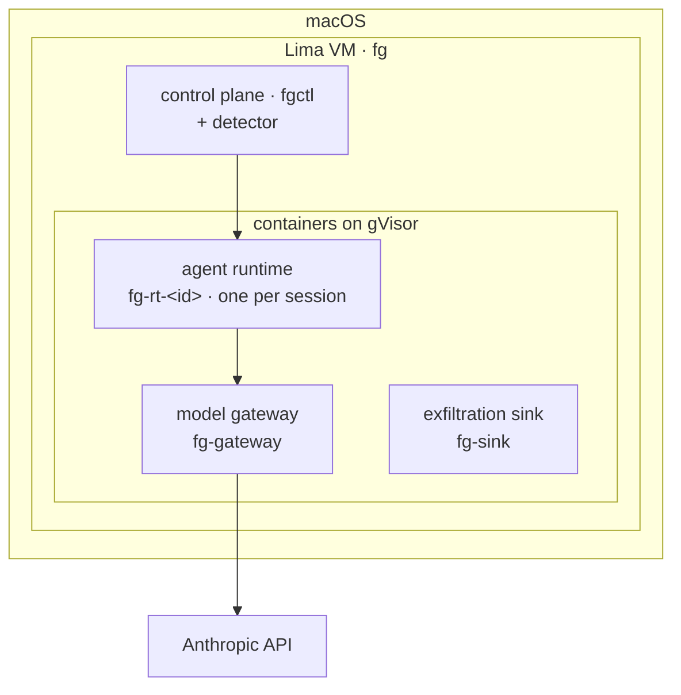
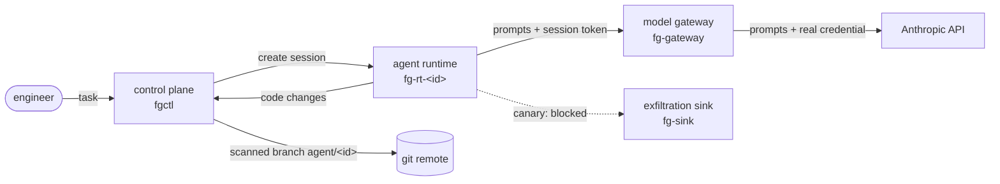
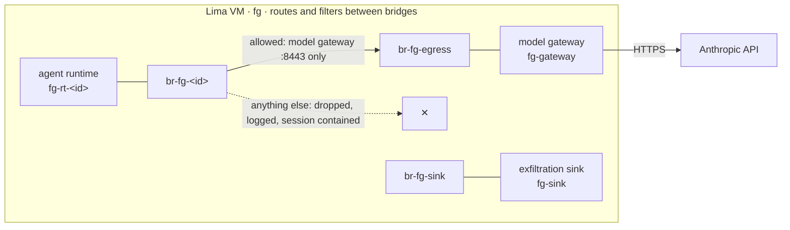
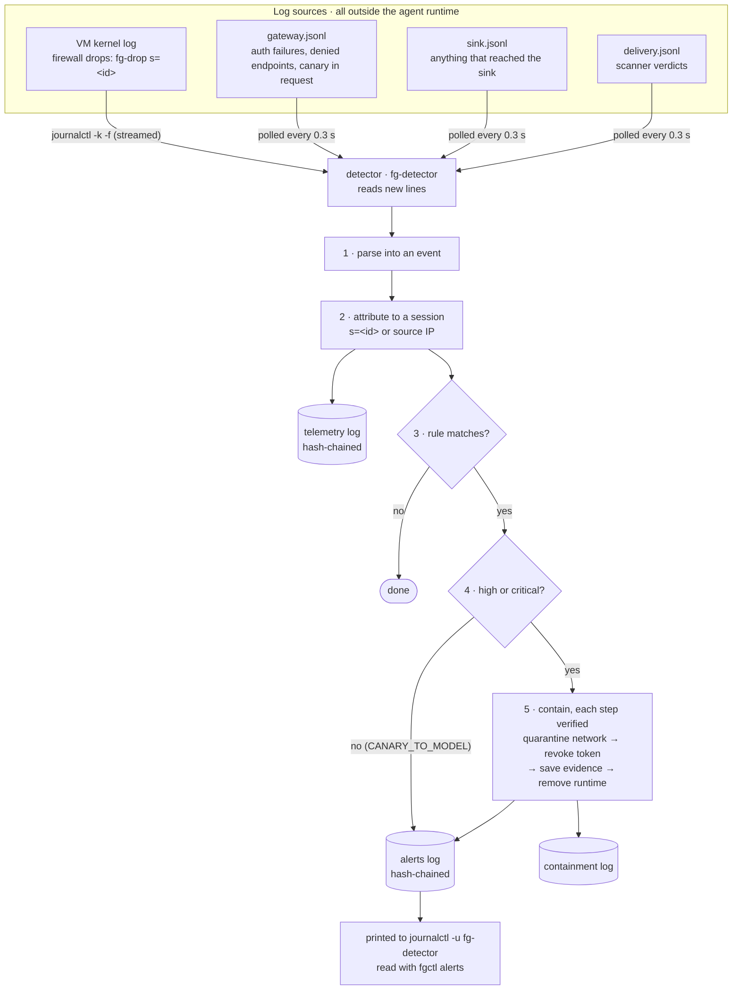

# Diagrams

Names follow the table in `docs/architecture.md`: display name, then the
resource name used in code and commands.

## 1. Components

## 2. Data flow

The agent runtime never holds the real credential. Its only way out is the
model gateway.

## 3. Network

Each session gets its own bridge. The VM routes only agent runtime → model
gateway; the rules live in the VM, outside the agent runtime's reach.

## 4. Detection and response

Rules: `EXFIL_SUCCESS` (critical), `EGRESS_BLOCKED`, `GATEWAY_ABUSE`,
`DELIVERY_BLOCKED`, `GATEWAY_EGRESS_BLOCKED` (high), `CANARY_TO_MODEL`
(medium). Containment is automatic; no one reviews an alert before it acts.
